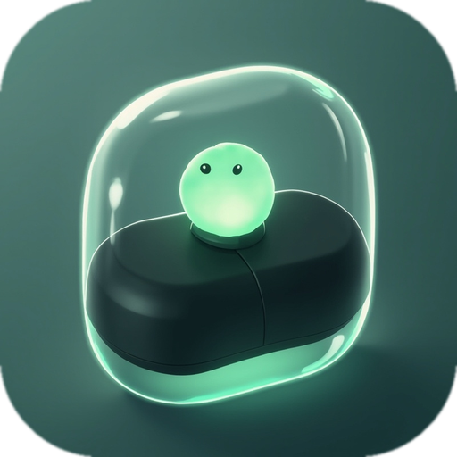

<div align="center">



# 灵栖 · Lingqi

**一座会呼吸的小岛。**

Windows 桌面灵动岛桌宠，把桌宠、AI 助手和本机状态收进屏幕顶边的一条小岛里。

</div>

灵栖基于开源项目 [「岛仔」Daozai](https://github.com/Renly1994/xiaotang-daozai)（MIT 许可）二次开发，
保留原作者版权声明与第三方许可声明。原项目的代码是很好的起点，但灵栖换掉了骨架：

| | 岛仔（上游） | 灵栖（本项目） |
| --- | --- | --- |
| 定位 | 桌面信息聚合岛 | **桌宠 + 灵动岛 + AI 助手** |
| 吉祥物 | 16 帧表情图集（美术素材） | **程序生成的精灵**：纯几何绘制，会呼吸、眨眼、跟着光标看，不依赖任何美术素材 |
| AI | 只查各家 AI 额度 | **灵动岛里的 AI 助手**：一句话记待办、问天气、总结剪贴板，上下文来自本机实时状态 |
| 功能面 | 邮件、日历、AI 额度、音乐歌词、蓝牙、消息、插件市集…… | **只留用得上的**：剪贴板、系统状态、天气、计时待办、AI；其余逐步下线 |
| 渲染 | egui 绘制全部内容 | 绘制内核（epaint）与 UI 框架解耦，为自研渲染器留出路径 |

## 下载

- [Releases 页面](https://github.com/NingYuanLee/lingqi/releases) —— 免安装 ZIP（含 `安装灵栖.cmd` 与 `收集灵栖诊断.cmd`）
- [源码](https://github.com/NingYuanLee/lingqi)

要求 Windows 10 / 11 x64；程序为静态链接，无需额外安装 C++ 运行库。

## 现在能做什么

- **顶边灵动岛**：收起是一条窄条，鼠标靠近展开；毛玻璃、圆角、避开其它窗口、多屏停靠。
- **程序生成的桌宠**：设置 → 外观 → 吉祥物形象，可切到「程序生成」。呼吸、眨眼、视线跟随都是时间轴驱动，休眠时会安静下来。
- **AI 助手**：托盘右键「AI 助手」打开。填好 DeepSeek API Key 后，可以说「记一下 明天下午三点取快递」「今天天气怎么样」「总结一下我刚复制的内容」。上下文包含本机时间、天气、电量、占用、正在播放的内容（按设置开关）。
- **剪贴板历史**：最近复制的文字一点即取，密码管理器标记为敏感的内容不记录。
- **系统状态**：电量、网络、音量、性能占用。
- **多时区**：在常驻条上并排显示多个城市的当前时间（设置 → 通用 → 多时区，填 IANA 时区名，最多 4 个；夏令时自动生效）。
- **天气**：实况与七日预报（Open-Meteo，免密钥）。
- **更省资源**（同机、各自默认设置实测）：

  | | 单核占用 | 常驻内存 |
  | --- | --- | --- |
  | 上游岛仔 v0.6.70 | 11.43% | 282.4 MB |
  | 灵栖 | **6.56%** | **177.9 MB** |

  功能对齐上游（手动打开音乐页）时为 6.44% / 212.9 MB。没人管它的时候，岛体会安静下来，
  重绘节奏从 20 帧降到 1~2 帧。

## 隐私

- API Key 存在 **Windows 凭据管理器**，不写配置文件、不进日志。
- AI 上下文默认**不含剪贴板**，需要时在设置里单独打开；疑似密钥或令牌的剪贴板内容整条丢弃。
- 本机状态（时间、天气、电量）只在你主动发问时才会被组装成提示词。
- 关闭 AI 助手后，不联网、不读凭据、不占资源。

## 从源码构建

需要 Rust stable（MSVC）、Visual Studio 生成工具（C++ 工作负载）与 Windows SDK。

```powershell
git clone <本仓库地址> D:\lingqi\source
cd D:\lingqi\source
cargo build --locked --release --bin lingqi
.\target\release\lingqi.exe
```

本机脚本（自动注入 VS 开发环境、把 target 放到工作区之外、串行构建）：

```powershell
pwsh -File D:\lingqi\build.ps1            # cargo check
pwsh -File D:\lingqi\build.ps1 -Release   # 出 release 包
```

> 注意：`CARGO_TARGET_DIR` 必须指向 DSH 等工具的工作区之外。放在工作区里时，MSVC 写中间文件会撞上
> 「文件被另一进程占用」，并以 `D8050 未能将命令行放入调试记录中` 的形式报错。

## 目录约定

| 路径 | 内容 |
| --- | --- |
| `src/native.rs` `src/layered.rs` `src/composition.rs` | Windows 原生外壳：透明分层窗、DirectComposition 合成、命中穿透 |
| `src/display_layout.rs` `src/side_dock.rs` `src/avoidance.rs` | 多屏停靠、避让其它窗口 |
| `src/sprite.rs` | 参数化精灵：纯 `epaint` 形状 + 时间轴 |
| `src/ai/` | AI 助手：流式对话、凭据、上下文、意图、抽屉界面 |
| `src/paint.rs` `src/shape.rs` | 岛体绘制与几何 |
| `src/net.rs` | 共享的网络出口（系统代理、带超时的 agent） |
| `vendor/` | 上游依赖的本地补丁（egui/eframe/egui-wgpu/egui-winit/wgpu-hal/ureq） |

**重要**：`vendor/wgpu-hal` 与 `vendor/egui-wgpu` 里有 DirectComposition 透明合成所必需的本地补丁，
升级这些依赖时必须把补丁一起重放，否则窗口会失去透明度。

## 许可与署名

- 代码：[MIT](LICENSE)。原项目版权行保留在本仓库 LICENSE 中，本项目版权行追加在后面。
- 第三方依赖与素材：见 [THIRD_PARTY_NOTICES.txt](THIRD_PARTY_NOTICES.txt) 与 [docs/DEPENDENCIES.md](docs/DEPENDENCIES.md)。
- 上游项目：[Renly1994/xiaotang-daozai](https://github.com/Renly1994/xiaotang-daozai)，MIT 许可，作者 小唐的Token。
- 原项目素材里的吉祥物图集、设备图标等**不随 MIT 授权**，本项目不再使用，改用程序生成的精灵。
